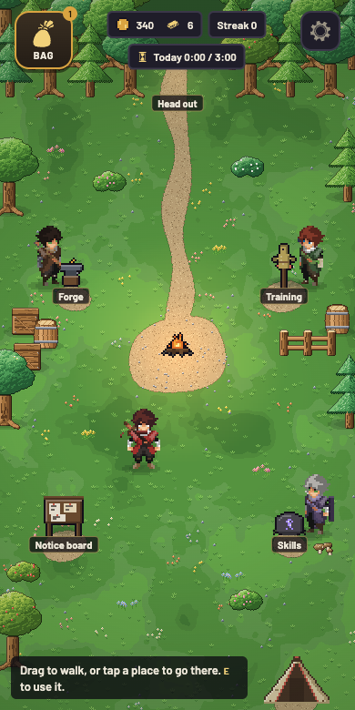
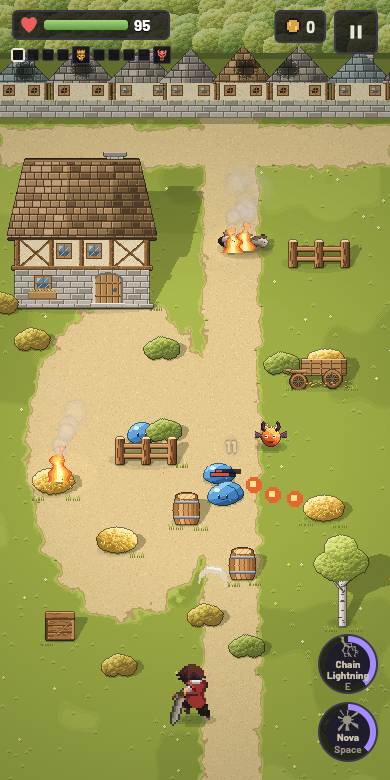
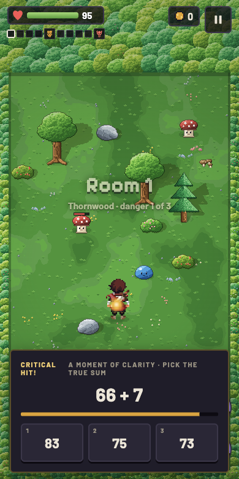
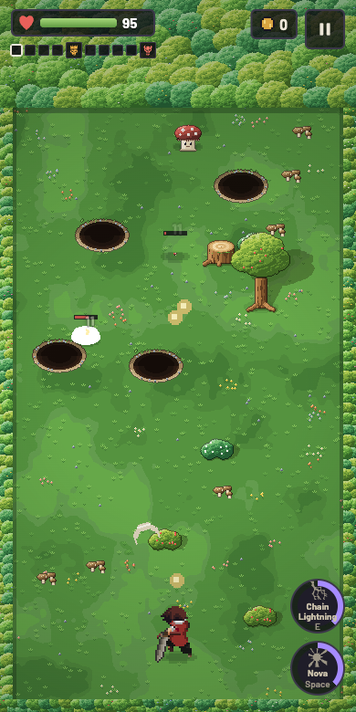
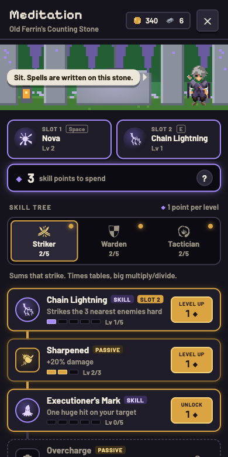
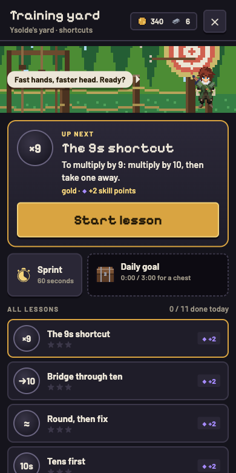

<p align="center">
  
</p>

<h1 align="center">Sum Quest</h1>

<p align="center">
  <b>A pixel-art action roguelite where mental math is your magic.</b><br>
  Dodge, fight and loot your way through Thornwood and Emberfall. Every crit, spell and forge strike is a sum.
</p>

<p align="center">
  
  
  
  
  
</p>

<p align="center">
  
  
  
</p>

## The idea

The world has lost its logic. Numbers ran away, and the creatures of the forest *miscount*.
Math is rare here, and it works like magic: spells are written as sums, and a wrong sum fizzles.

You fight like in an arena shooter: move to dodge, stand still to attack. The math is where your power comes from:

- **Critical hits** freeze time and give you a quick question with three answers. Right answer = a huge hit.
- **Spells** are typed answers. Each skill asks its own kind of math, and the faster you answer, the stronger it hits.
- **The forge and chests** ask a sum too. Harder sums give better odds, and exact answers are best.
- **Training lessons** teach real mental-math shortcuts, like *multiply by 9 = multiply by 10, then take one away*.

Wrong answers never hurt you. They just fizzle.

## Screenshots

<table>
  <tr>
    <td align="center"><br><sub>Thornwood: stand still to attack</sub></td>
    <td align="center"><br><sub>Emberfall: the burning village</sub></td>
    <td align="center"><br><sub>A crit: pick the true sum</sub></td>
  </tr>
  <tr>
    <td align="center"><br><sub>The camp between runs</sub></td>
    <td align="center"><br><sub>Meditation: the skill tree</sub></td>
    <td align="center"><br><sub>Training: math shortcuts</sub></td>
  </tr>
</table>

## What's in it

- **Two zones, one journey.** Ten rooms of Thornwood (slimes, spore-caps, wisps, charging boars, the mini boss Old Tusk and the boss Old Rootback), then ten rooms of burning Emberfall (imps, cinder hounds, Cinderjaw and the Cinder Golem).
- **Rooms with cover.** Trees, rocks and ruins block shots. Lure a charging boar into a rock to daze it.
- **Gear you can see.** Eight slots, rarities from Common to Legendary, and four sets. Everything you wear shows on your hero.
- **A skill tree.** Three branches (Striker, Warden, Tactician): spells like Chain Lightning, Nova, Frost Field and Meteor, plus passives.
- **A camp to come home to.** Walk to the Forge, the Training yard, the Notice board or the Meditation stone.
- **It learns what you need.** A memory model tracks every fact, so what comes back is what you're about to forget. Difficulty keeps you at about 85% right, where learning is fastest.
- **A daily habit.** A 3-minute daily goal with a chest, streaks, and a 60-second Sprint to beat your own best.

## How to play

| | Phone | Keyboard |
|---|---|---|
| Move | Drag anywhere | WASD / arrows |
| Attack | Stand still | Stand still |
| Skills | Tap the skill buttons | Space / E |
| Crit answer | Tap an answer | 1 / 2 / 3 |
| Typed answers | Keypad | Digits, then Enter or Space |
| Use a camp station | Tap it | E, Enter or Space |
| Bag / Pause | Top buttons | I / Esc |

Play in the browser on a phone or a computer. On iPhone, **Share → Add to Home Screen** installs it as an app
that works offline.

## Run it yourself

```bash
npm install
npm run dev     # http://localhost:5173, and on your phone through the network URL
npm test
```

How it's built, where everything lives and how to publish it: [docs/development.md](docs/development.md).
The story and the math-as-magic plan: [docs/lore.md](docs/lore.md).

## Privacy

No accounts, no cookies, no tracking. Your save stays on your device. Settings → **Backup save** gives you a code
to move your progress to another device.

## Credits

- Hero sprite: **[Adventurer 2D Top-Down](https://xzany.itch.io/top-down-adventurer-character)** by Mattz Art (free
  version), used and modified under its licence. Gear and weapons are drawn on top of it in code.
- Interface icons: **[game-icons.net](https://game-icons.net)** by Lorc, Delapouite and contributors,
  [CC BY 3.0](https://creativecommons.org/licenses/by/3.0/), via the `@iconify-json/game-icons` package.
- Everything else (enemies, camp, props, items, UI) is drawn in code in this repo. The bright top-down look is
  inspired by Cainos' "Pixel Art Top Down" packs; none of their assets are used.

Made by [RickardOtv](https://github.com/RickardOtv).
