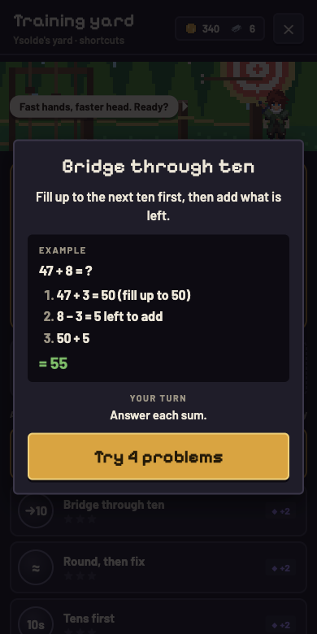

<p align="center">
  
</p>

<h1 align="center">Sum Quest</h1>

<p align="center">
  A top-down action roguelite made for phones, for practising mental math. Built on learning research.<br>
  Critical hits, spells and upgrades are earned by solving arithmetic.
</p>

<p align="center">
  <a href="https://sum-quest.rickardotvos.workers.dev"></a>
</p>

<p align="center">
  
  
  
  
  
</p>

## About

Sum Quest combines a top-down action game with mental-math practice. You move to dodge and stand still to
attack. Critical hits, spells, chests and gear upgrades each ask a math question. A wrong answer costs you the
bonus, nothing more.


## Screenshots

<div align="center">
<table>
  <tr>
    <td align="center"><br><sub>Camp</sub></td>
    <td align="center"><br><sub>Combat in Emberfall</sub></td>
    <td align="center"><br><sub>Critical hit question</sub></td>
  </tr>
  <tr>
    <td align="center"><br><sub>Training</sub></td>
    <td align="center"><br><sub>Lesson</sub></td>
    <td align="center"><br><sub>Skill tree</sub></td>
  </tr>
</table>
</div>

## Features

- Two zones, 20 rooms, with mini bosses and bosses.
- Math-driven combat: multiple-choice critical hits and typed-answer spells.
- Gear with rarities and sets, and a skill tree with three branches.
- Adaptive difficulty aimed at about 85% accuracy, with spaced repetition.
- Short lessons on mental-math techniques, a daily 3-minute goal and a 60-second sprint mode.

## Built on learning research

Sum Quest started from reading research on how people learn and remember best. Each part of the practice
system follows a specific finding:

| Principle | In the game |
|---|---|
| **Spaced repetition** | Every fact has a memory half-life. Questions come back just as you are about to forget them. |
| **Retrieval practice** | You recall answers instead of rereading them. Important moments ask for a typed answer, not a choice. |
| **The 85% rule** | Difficulty adjusts per category to keep you at about 85% correct, where learning is fastest. |
| **Interleaving** | Problem types are mixed rather than practised in blocks. |
| **Limited overlearning** | Facts you just answered fluently are held back for the rest of the session. |
| **Worked examples** | Lessons show a strategy step by step before you practise it. Solutions are shown after a run, not mid-fight. |
| **Intrinsic integration** | Math is how you win, through crits, spells and upgrades, not a quiz that interrupts the game. |

<details>
<summary>Sources</summary>

- Settles & Meeder (2016). *A trainable spaced repetition model for language learning.* ACL. (half-life memory model)
- Roediger & Karpicke (2006). *Test-enhanced learning: taking memory tests improves long-term retention.* Psychological Science.
- Wilson, Shenhav, Straccia & Cohen (2019). *The Eighty Five Percent Rule for optimal learning.* Nature Communications.
- Rohrer & Taylor (2007). *The shuffling of mathematics problems improves learning.* Instructional Science.
- Rohrer, Taylor, Pashler, Wixted & Cepeda (2005). *The effect of overlearning on long-term retention.* Applied Cognitive Psychology.
- Sweller & Cooper (1985). *The use of worked examples as a substitute for problem solving in learning algebra.* Cognition and Instruction.
- Habgood & Ainsworth (2011). *Motivating children to learn effectively: exploring the value of intrinsic integration in educational games.* Journal of the Learning Sciences.

</details>

## Run it yourself

```bash
npm install
npm run dev     # http://localhost:5173, and on your phone through the network URL
npm test
```

Architecture, file layout and deployment: [docs/development.md](docs/development.md).
Setting and design notes: [docs/lore.md](docs/lore.md).

## Privacy

No accounts, cookies or tracking. Progress is stored locally on the device.

## Credits

- Hero sprite: **[Adventurer 2D Top-Down](https://xzany.itch.io/top-down-adventurer-character)** by Mattz Art (free
  version), used and modified under its licence. Gear and weapons are drawn on top of it in code.
- Interface icons: **[game-icons.net](https://game-icons.net)** by Lorc, Delapouite and contributors,
  [CC BY 3.0](https://creativecommons.org/licenses/by/3.0/), via the `@iconify-json/game-icons` package.
- Everything else (enemies, camp, props, items, UI) is drawn in code in this repo. The visual style is inspired
  by Cainos' "Pixel Art Top Down" packs; no assets from them are used.

Made by [RickardOtv](https://github.com/RickardOtv).
